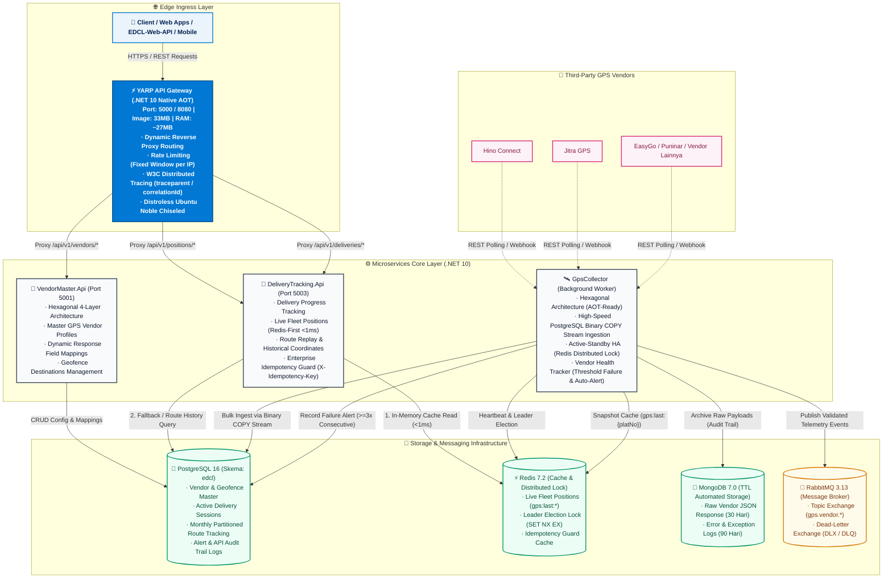

<div align="center">

# 🛰️ EDCL GPS API — Fleet GPS Telematics & Ingestion Platform

**Platform Microservices Penyerapan & Observabilitas Telemetri GPS Armada Truk Real-Time Berstandar *Enterprise* untuk Ekosistem Logistik Toyota Motor Manufacturing Indonesia (TMMIN).**

[](https://dotnet.microsoft.com)
[](https://learn.microsoft.com/dotnet/core/deploying/native-aot/)
[](https://microsoft.github.io/reverse-proxy/)
[](https://www.postgresql.org)
[](https://redis.io)
[](https://www.mongodb.com)
[](https://www.rabbitmq.com)
[](https://opentelemetry.io)

</div>

---

## 📖 Ringkasan Eksekutif

**EDCL GPS API** (`EDCLGPSAPI`) adalah platform microservices terdistribusi (*cloud-native telemetry platform*) berbasis **.NET 10** yang dirancang khusus untuk menangani penyerapan (*ingestion*), standardisasi, penyimpanan terpartisi, dan pengaliran (*streaming*) data koordinat pelacakan GPS armada truk logistik pemasok komponen suku cadang secara *real-time*.

Platform ini beroperasi di garis terdepan (*Public Edge Ingress*) untuk mengumpulkan data telemetri dari beragam vendor GPS pihak ketiga (*Hino Connect, Jitra GPS, Puninar, EasyGo, dll.*) melalui internet publik, menormalkan struktur data yang heterogen melalui *dynamic mapping engine*, lalu mengalirkannya secara andal ke **`EDCL-Web-API`** yang berada di dalam **Jaringan Privat / Intranet TMMIN (On-Premises Plant Core)**.

### Nilai Strategis Pemisahan Service:
1. **Isolasi Beban Write-Heavy Berkecepatan Tinggi**: Ratusan armada truk logistik mengirimkan titik koordinat setiap 1 menit (akumulasi jutaan rekam jejak GPS per hari). Menggunakan **PostgreSQL Binary COPY Streaming (`NpgsqlBinaryImporter`)**, platform ini menjamin server database transaksional inti di pabrik TMMIN (*SQL Server*) terbebas 100% dari beban *I/O disk* koordinat mentah.
2. **Keamanan Korporat (Zero-Trust Isolation)**: Server pabrik TMMIN tidak membuka port inbound publik ke internet untuk vendor GPS. Seluruh penyerapan data berlangsung di lingkungan terisolasi dengan container distroless *chiseled*, kemudian dialirkan melalui jalur privat terenkripsi (*TLS/VPN/AMQPS*).
3. **Agilitas Integrasi Vendor (Zero-Downtime Deployment)**: Struktur data vendor pihak ketiga bervariasi dan dapat berubah sewaktu-waktu. Mesin *dynamic mapping* berbasis database (`tb_m_mapping`) memungkinkan penambahan vendor baru tanpa memerlukan *re-compilation* maupun *deployment downtime*.
4. **Ketahanan Konektivitas Vendor Otonom**: Dilengkapi dengan **Automated Vendor Health Tracker** yang memonitor kegagalan endpoint vendor secara real-time dan secara otomatis memicu notifikasi peringatan (*Alert Triggered*) jika vendor tidak merespons berkali-kali berturut-turut, serta mencatat pemulihan (*Alert Resolved*) saat koneksi kembali normal.

---

## 🏛️ Arsitektur Platform Microservices

Platform ini dibangun dengan prinsip **Hexagonal Architecture (Ports & Adapters)** dan **Lean Microservices (Pure Delivery-Centric Model)**, memisahkan domain tanggung jawab ke dalam 3 layanan inti independen yang terisolasi (*self-contained*) dan 1 Ingress API Gateway Native AOT:



---

## 🌟 Fitur Utama Sistem

### 1. ApiGateway Berteknologi Native AOT (.NET 10)
- **Kompilasi Mesin Asli (Native Machine Code)**: Dikonfigurasi dengan `<PublishAot>true</PublishAot>` dan source generator System.Text.Json, menghasilkan executable biner ELF tunggal mandiri.
- **Ultra-Fast Cold Start**: Waktu inisiasi (*startup*) terpangkas drastis menjadi **< 15 milidetik** (dibandingkan runtime JIT standar yang memerlukan 800–1.500 ms).
- **Efisiensi Memori Ekstrem**: Mengonsumsi memori kerja hanya **~27 MiB RAM** saat beroperasi penuh melayani rute proxy.
- **Container Distroless Chiseled**: Menggunakan image basis `mcr.microsoft.com/dotnet/runtime-deps:10.0-noble-chiseled` menghasilkan ukuran container akhir hanya **33 MB** tanpa *shell* (`/bin/sh`) atau *package manager*, meminimalisir potensi serangan siber (*attack surface*).

### 2. High-Speed Bulk Ingestion via PostgreSQL Binary COPY Stream
- **Zero-Reflection & Zero-ORM Overhead**: Pada modul `GpsCollector`, proses penyimpanan rekam jejak koordinat armada (`tb_r_gps_last_position_h`, `tb_r_gps_last_position_d`, dan `tb_r_gps_delivery`) menggunakan **`NpgsqlBinaryImporter` (PostgreSQL Binary COPY)** langsung ke soket database.
- **Throughput Ingestion Maksimal**: Menghindari beban alokasi memori, tracking context, dan refleksi SQL INSERT per-baris, mampu menyerap puluhan ribu koordinat armada dalam hitungan milidetik.

### 3. Automated Vendor Health Tracker & Alert Notifier
- **Deteksi Kegagalan Berkala**: Komponen `VendorHealthTracker` melacak statistik konektivitas setiap endpoint vendor GPS secara *thread-safe* (`ConcurrentDictionary`).
- **Consecutive Failure Threshold**: Jika pemanggilan endpoint vendor gagal berulang kali melebihi ambang batas yang dikonfigurasi (default: **3 kali berturut-turut** akibat *network timeout*, *DNS error*, atau HTTP 5xx), sistem secara otomatis memicu event `VendorAlertEvent` dengan status `ALERT_TRIGGERED`.
- **Database Alert Logging**: Notifikasi alert otomatis disimpan ke dalam tabel PostgreSQL `edcl.tb_m_gps_api_log` dengan level peringatan, deskripsi kegagalan, dan rekam jejak waktu (*timestamp*).
- **Auto-Recovery Detection**: Saat koneksi ke vendor GPS berhasil pulih kembali, sistem secara otomatis mencatat event `ALERT_RESOLVED` dan mereset penghitung kegagalan ke 0.

### 4. Dynamic Response Field Mapping (`tb_m_mapping`)
- Sistem tidak mengikat skema DTO secara kaku ke satu vendor. Melalui tabel master `edcl.tb_m_mapping`, nama field respons JSON vendor (misalnya `lat`, `latitude`, `y_pos`) dipetakan secara dinamis pada *runtime* ke field standar EDCL (`Y`), dan longitude ke (`X`) menggunakan navigasi path token JSON berkecapatan tinggi.

### 5. Multi-Protocol Vendor Authentication & Self-Healing Token Rotation
Mendukung strategi autentikasi vendor pihak ketiga secara otonom:
- **NoAuth / Public Parameter**
- **Bearer Token / Dynamic JWT** (dilengkapi rotasi token otomatis berkala melalui Polly v8 pipeline)
- **Basic Authentication** (kredensial terenkripsi)
- **API Key / Custom Header Param**

### 6. Dual-Tier Storage Architecture (PostgreSQL 16 + MongoDB 7)
- **PostgreSQL 16 (Pure Delivery-Centric Storage Model)**: Riwayat spasial terstruktur hanya mencatat armada dengan sesi pengiriman aktif dari klik "Start Job" di `EDCLWEBAPI`. Riwayat rute disimpan pada partisi rentang bulanan (*monthly range partitioning*) yang diindeks B-Tree & BRIN.
- **MongoDB 7 (TTL Automated Cleanup)**:
  - `gps_api_logs`: Seluruh pesan galat dan HTTP status error disimpan dalam format BSON dengan masa kedaluwarsa otomatis 90 hari.
  - `gps_raw_responses`: Payload JSON mentah dari vendor disimpan untuk keperluan audit dan replay jika mapping berubah (TTL 30 hari).

### 7. Redis High-Speed Position Caching & Distributed Leader Election
- **Redis-First Read Engine**: Endpoint kueri posisi armada pada `DeliveryTracking.Api` mengecek memori Redis terlebih dahulu (latensi < 1ms) sebelum melakukan *fallback* ke PostgreSQL.
- **Worker Active-Standby Leader Election**: Worker `GpsCollector` menerapkan *distributed lock* (`SET NX EX`) melalui Redis. Hanya 1 instance yang aktif melakukan polling, sementara instance standby siap mengambil alih secara instan jika terjadi kegagalan (*failover*).

### 8. Event-Driven Messaging (RabbitMQ with DLX/DLQ)
Setiap paket koordinat yang divalidasi langsung diterbitkan ke `topic_exchange` dengan *routing key* berbasis vendor (`gps.vendor.<vendor_code>`). Dilengkapi dengan *Dead Letter Exchange* (`edcl.telematics.dlx`) dan *Retry Queue* untuk menjamin keandalan pengiriman pesan 100% tanpa risiko kehilangan data.

### 9. End-to-End Tracing & Correlation Standardization
Menerapkan standar industri W3C terpadu untuk pelacakan alur data dan logging di seluruh microservices:
- **HTTP Response Headers**:
  ```http
  X-Trace-Id: 45cf5f6b5f21d52485329ff1a86f365c
  X-Correlation-Id: 45cf5f6b5f21d52485329ff1a86f365c
  ```
- **JSON Response Body**:
  ```json
  {
    "service": "EDCL Telematics API Gateway",
    "engine": "YARP Reverse Proxy (.NET 10 Native AOT)",
    "status": "Healthy",
    "version": "2.1.0",
    "traceId": "45cf5f6b5f21d52485329ff1a86f365c",
    "correlationId": "45cf5f6b5f21d52485329ff1a86f365c"
  }
  ```

### 10. Enterprise Idempotency Protection (`X-Idempotency-Key`)
Mencegah mutasi ganda (*double-click* atau *network retry*) pada endpoint transaksi:
- **Wajib (*Required*)**: Client mengirimkan header `X-Idempotency-Key: <UUID>`.
- **Anti-Double Request Simultan**: Jika request sedang berjalan, request paralel kedua langsung mendapat status `409 Conflict`.
- **Payload Hash Guard**: Memverifikasi SHA-256 payload body. Jika key dipakai ulang untuk isi yang berbeda, sistem mengembalikan status `422 Unprocessable Entity`.
- **Instant Cached Replay**: Request ulang dengan payload yang sama langsung dikembalikan dari cache Redis (`X-Cache: HIT`, `X-Idempotent-Replayed: true`).

---

## 🧩 Struktur Direktori Solusi

```
EDCLGPSAPI/
├── src/
│   ├── Services/
│   │   ├── ApiGateway/                       # YARP Gateway .NET 10 Native AOT (Port 5000 / 8080)
│   │   │   ├── Dockerfile                   # Multi-stage AOT with Ubuntu Noble Chiseled (33MB)
│   │   │   └── Program.cs                   # Rate Limiter, W3C Tracing, Source Gen Minimal API
│   │   ├── GpsCollector/                     # Hexagonal Background Telematics Ingestion Service
│   │   │   ├── Domain/                      # Core Models (TelemetryPoint, VendorConfig, VendorAlertEvent)
│   │   │   ├── Application/                 # Orchestrator, Ports (IPorts.cs), AOT JSON Context
│   │   │   ├── Infrastructure/              # Adapters (Npgsql Binary COPY, Mongo, Redis, RabbitMQ, Health Tracker)
│   │   │   └── Workers/                     # GpsCollectorWorker (BackgroundService + Leader Election)
│   │   ├── VendorMaster/                     # Hexagonal Vendor & Geofence Master Management
│   │   │   ├── VendorMaster.Domain          # Domain Entities, Enums, Value Objects
│   │   │   ├── VendorMaster.Application     # CQRS Handlers, DTOs, FluentValidation
│   │   │   ├── VendorMaster.Infrastructure  # EF Core PostgreSQL Persistence, Repositories
│   │   │   └── VendorMaster.Api             # REST Endpoints, Swagger, OpenTelemetry (Port 5001)
│   │   └── DeliveryTracking.Api/             # Unified Fleet Tracking & Delivery Progress (Port 5003)
│   │       ├── Application/                 # Query Services, Ports & DTOs
│   │       ├── Domain/                      # Delivery Entities & Coordinate Models
│   │       ├── Endpoints/                   # Minimal API Endpoints (/api/v1/positions, /gps-lastposition)
│   │       └── Infrastructure/              # Redis-First Repository & ADO.NET PostgreSQL Engine
│   ├── Shared/
│   │   ├── Shared/                           # Kernel, Idempotency, Telemetry, Npgsql / Mongo / Redis
│   │   ├── Shared.Contracts/                 # Integration Contracts & Events
│   │   ├── Shared.Messaging/                 # Messaging Abstractions
│   │   └── Shared.Messaging.RabbitMqClient/  # RabbitMQ Resilience Publisher & Consumer
│   ├── docker-compose.yml                    # Multi-container Compose Stack
│   └── edcl-gps-api.sln                      # Visual Studio / .NET 10 Solution
├── database/                                 # Skrip DDL PostgreSQL, MongoDB init, Prometheus & RabbitMQ config
├── deploy/
│   ├── k8s/                                  # Kubernetes Manifests (k3d / Minikube / EKS)
│   └── aws/                                  # Panduan & Konfigurasi AWS EKS Production Deployment
├── tests/                                    # 76 Unit & Integration Tests (100% Passing)
│   └── Services/
│       ├── DeliveryTracking/
│       ├── GpsCollector/
│       └── VendorMaster/
├── ARCHITECTURE.md                           # Cetak Biru Arsitektur Lengkap
├── DECOMMISSIONING_PLAN.md                   # Dokumentasi Dekomposisi & Audit Trail
└── MICROSERVICES_PLAN.md                     # Rencana Dekomposisi & Strategi Database
```

---

## 🚀 Panduan Menjalankan Sistem (Local Development)

### 1. Prasyarat Sistem
- **Docker & Docker Compose** (v24.0+)
- **.NET 10 SDK** (jika menjalankan langsung via CLI / Visual Studio)

---

### 2. Menjalankan Seluruh Stack via Docker Compose (Rekomendasi)

Jalankan perintah berikut di root folder proyek:

```bash
docker compose -f src/docker-compose.yml up -d --build
```

Seluruh layanan aplikasi, infrastruktur database, message broker, dan monitoring akan aktif secara otomatis:

| Layanan / Komponen | Port Host | Deskripsi / URL Akses | Status Runtime |
|---|---|---|---|
| **YARP API Gateway** | **`5000 / 8080`** | `http://localhost:5000/` (Health check: `/hc`) | **.NET 10 Native AOT (33MB)** |
| **Vendor Master API** | **`5001`** | `http://localhost:5001/swagger` (Metrik: `/metrics`) | .NET 10 |
| **Delivery Tracking API** | **`5003`** | `http://localhost:5003/swagger` (Positions & Routes) | .NET 10 (Redis-First) |
| **GPS Collector Worker** | — | Background ingestion daemon (Metrik: `/metrics`) | .NET 10 Hexagonal (Binary COPY) |
| **Prometheus Server** | **`9090`** | Dashboard scrape metrik: `http://localhost:9090/` | Prometheus v2.50+ |
| **Grafana Dashboard** | **`3000`** | Visualisasi Telemetri: `http://localhost:3000/` *(User: `admin`, Pass: `admin`)* | Grafana v10+ |
| **PostgreSQL Database** | **`5436`** | Port 5436 *(User: `edcl_gps_user`, DB: `AE031_EDCL_GPS_DB`)* | PostgreSQL 16 |
| **MongoDB NoSQL** | **`27017`** | Port 27017 *(DB: `edcl_logs_db`)* | MongoDB 7.0 (TTL Indexed) |
| **Redis Cache** | **`6379`** | Port 6379 *(Live Position Snapshot & Leader Lock)* | Redis 7.2 |
| **RabbitMQ Management** | **`15672`** | `http://localhost:15672/` *(User: `guest`, Pass: `guest`)* | RabbitMQ 3.13 (Management UI) |

---

### 3. Menjalankan Layanan Secara Terpisah via .NET CLI

Jika ingin melakukan *debugging* langsung pada satu atau beberapa layanan tertentu:

```bash
# 1. Jalankan API Gateway (.NET 10)
dotnet run --project src/Services/ApiGateway

# 2. Jalankan Vendor & Geofence Master API
dotnet run --project src/Services/VendorMaster/VendorMaster.Api

# 3. Jalankan Delivery Tracking API (termasuk Live Position & Route Tracking)
dotnet run --project src/Services/DeliveryTracking.Api

# 4. Jalankan Background Collector Worker
dotnet run --project src/Services/GpsCollector
```

---

### 4. Menjalankan Test Suite (Unit & Integration Tests)

Seluruh 76 automated tests pada solution dapat dijalankan dengan perintah:

```bash
dotnet test src/edcl-gps-api.sln
```

---

## 🔒 Tata Kelola Keamanan & Kepatuhan Industri
- **Enkripsi Kredensial**: Seluruh kata sandi vendor dan token API disimpan dalam bentuk terenkripsi atau dikelola via AWS Secrets Manager saat berjalan di Kubernetes / Fargate.
- **TLS/SSL Encryption in Transit**: Pertukaran pesan antara AWS Cloud dan TMMIN Private Network diwajibkan menggunakan protokol `AMQPS` (TLS 1.3) dan saluran VPN terisolasi.
- **Audit Kemampuan Telusur (*Traceability*)**: Pelacakan end-to-end terhubung melalui W3C `X-Trace-Id` dan `X-Correlation-Id` pada setiap log dan respons API.
- **Anti-Duplikasi Data**: Perlindungan `X-Idempotency-Key` menjamin tidak terjadi mutasi ganda data logistik penting pada kondisi jaringan terputus-putus.
- **Distroless Runtime**: Container Native AOT tidak menyertakan shell, package manager, ataupun compiler di production container.

---

<div align="center">

**EDCL GPS Telematics Platform** — *Sub-system of EDCL-Web-API, Toyota Motor Manufacturing Indonesia (TMMIN) Logistics Ecosystem.*

</div>
