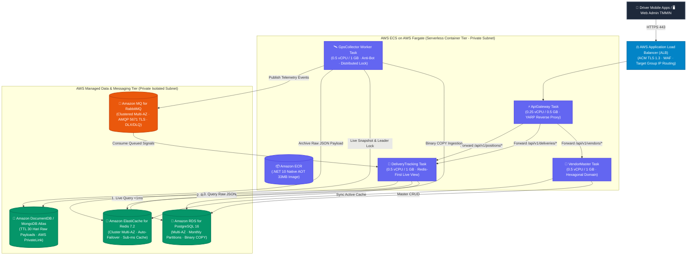

<div align="center">

# 🛰️ EDCL GPS API — Fleet GPS Telematics & Ingestion Platform

**Platform Microservices Penyerapan & Observabilitas Telemetri GPS Armada Truk Real-Time Berstandar *Enterprise* untuk Ekosistem Logistik Toyota Motor Manufacturing Indonesia (TMMIN).**

[](https://dotnet.microsoft.com)
[](https://learn.microsoft.com/dotnet/core/deploying/native-aot/)
[](https://microsoft.github.io/reverse-proxy/)
[](https://www.postgresql.org)
[](https://redis.io)
[](https://www.mongodb.com)
[](https://www.rabbitmq.com)
[](https://github.com/odealidj/EDCLGPSAPI)
[](https://opentelemetry.io)
[](https://prometheus.io)
[](https://grafana.com)

</div>

---

## 📖 Ringkasan Eksekutif

**EDCL GPS API** (`EDCLGPSAPI`) adalah platform microservices terdistribusi (*cloud-native telemetry ingestion platform*) berstandar enterprise yang dirancang khusus untuk mengelola penyerapan (*high-throughput ingestion*), normalisasi struktur data heterogen, penyimpanan terpartisi (*partitioned polyglot storage*), dan pengaliran (*real-time event streaming*) data koordinat pelacakan GPS armada truk logistik pemasok komponen suku cadang pabrik TMMIN secara *real-time*.

Platform ini beroperasi di garda terdepan (*Public Edge Ingress*) untuk mengonsumsi data telemetri dari beragam vendor GPS pihak ketiga (*Inovatrack, Muliatrack, Puninar, Dunex, Hino Connect, dll.*) melalui internet publik, menormalkan struktur data yang heterogen secara dinamis via *mapping engine*, lalu mengalirkannya secara andal ke **`EDCL-Web-API`** yang berada di dalam **Jaringan Privat / Intranet TMMIN (On-Premises Plant Core)**.

### Nilai Strategis Pemisahan Service:
1. **Isolasi Beban Write-Heavy Berkecepatan Tinggi**: Ratusan armada truk logistik memancarkan koordinat secara berkala (akumulasi jutaan rekam jejak GPS harian). Menggunakan **PostgreSQL Binary COPY Streaming (`NpgsqlBinaryImporter`)** pada skema murni delivery (`edcl.t_delivery_latest_position` & `edcl.t_delivery_position_history`), platform ini menjamin server database transaksional inti di pabrik TMMIN (*SQL Server*) terbebas 100% dari beban *I/O disk* koordinat mentah.
2. **Keamanan Korporat (Zero-Trust Isolation)**: Server pabrik TMMIN tidak membuka port inbound publik ke internet untuk vendor GPS. Seluruh penyerapan data berlangsung di lingkungan terisolasi dengan container distroless *chiseled* Native AOT, kemudian dialirkan melalui jalur privat terenkripsi (*TLS/VPN/AMQPS*).
3. **Agilitas Integrasi Vendor (Zero-Downtime Deployment)**: Struktur data vendor pihak ketiga bervariasi dan dapat berubah sewaktu-waktu. Mesin *dynamic mapping* berbasis database (`edcl.m_gps_vendor_mapping`) memungkinkan penambahan dan penyesuaian vendor baru tanpa memerlukan *re-compilation* maupun *deployment downtime*.
4. **Ketahanan Konektivitas Vendor Otonom**: Dilengkapi dengan **Automated Vendor Health Tracker** yang memonitor kegagalan endpoint vendor secara real-time dan secara otomatis memicu notifikasi peringatan (*Alert Triggered*) jika vendor tidak merespons berulang kali berturut-turut, serta mencatat pemulihan (*Alert Resolved*) saat koneksi kembali normal.
5. **Anti-Bot Throttling, Anti-Blacklist & On-Demand Telematics**: Sistem tidak melakukan polling secara membabi buta. Jika tidak ada job pengiriman aktif untuk LPCD vendor terkait, HTTP request ke vendor dilewati (zero calls). Polling vendor diatur secara acak non-periodik di development (35-75 detik) dan 60 detik di production dengan Chrome header emulation dan automatic backoff penalty (3 menit saat HTTP 429, 5 menit saat HTTP 403) untuk melindungi IP server dari pemblokiran WAF vendor pihak ketiga.

---

## 🏛️ Arsitektur Sistem Terdistribusi

Berikut adalah visualisasi arsitektur sistem holistik **EDCL GPS Telematics Platform**:

```mermaid
graph TD
    classDef client fill:#3b82f6,stroke:#2563eb,stroke-width:2px,color:#fff;
    classDef gateway fill:#0284c7,stroke:#0369a1,stroke-width:2px,color:#fff;
    classDef service fill:#4f46e5,stroke:#4338ca,stroke-width:2px,color:#fff;
    classDef worker fill:#f97316,stroke:#ea580c,stroke-width:2px,color:#fff;
    classDef db fill:#f1f5f9,stroke:#94a3b8,stroke-width:2px,color:#0f172a;
    classDef cache fill:#ef4444,stroke:#dc2626,stroke-width:2px,color:#fff;
    classDef mq fill:#ff6600,stroke:#ea580c,stroke-width:2px,color:#fff;
    classDef telemetry fill:#10b981,stroke:#059669,stroke-width:2px,color:#fff;
    classDef external fill:#0d9488,stroke:#0f766e,stroke-width:2px,color:#fff;

    Admin["🖥️ Web Admin / EDCL Core System"]:::client
    Mobile["📱 Mobile Driver App / Logistics Client"]:::client

    subgraph "Edge Ingress Layer (Native AOT)"
        Gateway["⚡ YARP API Gateway (.NET 10 Native AOT)<br/>(Image: 33MB · RAM: ~27MB · Reverse Proxy · Rate Limiter)"]:::gateway
    end

    subgraph "Microservices Core Layer (.NET 10)"
        VendorMaster["🏢 VendorMaster.Api (:5001)<br/>(Hexagonal Core · Vendor Profiles · Permanent Redis Cache Sync)"]:::service
        DeliveryTracking["🚚 DeliveryTracking.Api (:5003)<br/>(Live Positions · Redis-First <1ms · Route Replay · MongoDB Raw Query)"]:::service
    end

    subgraph "Asynchronous Workers & Ingestion Engine"
        Collector["🛰️ GpsCollector Worker (:5004)<br/>(Hexagonal · On-Demand Polling · Anti-Bot Throttling · Binary COPY)"]:::worker
        HealthTracker["🩺 Vendor Health Tracker<br/>(Failure Detection · Alert Resolved · Two-Tier Observability)"]:::worker
    end

    subgraph "Data & Messaging Infrastructure"
        PG[("🐘 PostgreSQL 16 (edcl)<br/>(Vendor Master · Delivery Sessions · Partitioned Routes)")]:::db
        Redis[("🔴 Redis 7.2 Cache<br/>(Live Positions Snapshot · Permanent Vendor Cache · Leader Lock)")]:::cache
        Mongo[("🍃 MongoDB 7.0<br/>(Raw Payloads TTL 30 Hari · Audit Logs TTL 90 Hari)")]:::db
        RabbitMQ[("🐰 RabbitMQ 3.13<br/>(Topic Exchange gps.vendor.* · DLX / DLQ Retry)")]:::mq
    end

    subgraph "Observability & Telemetry Ecosystem"
        OTel["🛡️ OpenTelemetry .NET SDK<br/>(W3C Distributed Tracing & Metrics)"]:::telemetry
        Prometheus["📈 Prometheus Engine (:9090)<br/>(PromQL Scraper /metrics)"]:::telemetry
        Grafana["📊 Grafana Dashboard (:3000)<br/>(Live Telematics Visualizer)"]:::telemetry
        Seq["📋 Seq Centralized Logs (:5341)<br/>(Structured Log Analytics)"]:::telemetry
    end

    subgraph "External Integrations (Real GPS Vendors)"
        Inovatrack["📡 Inovatrack (AJL/TMMIN2 · >30s)"]:::external
        Muliatrack["📡 Muliatrack (MLT · Watermark Cursor)"]:::external
        Puninar["📡 Puninar (PNR · POST Token Header)"]:::external
        Dunex["📡 Dunex (DNX · API Key)"]:::external
        Hino["📡 Hino Connect (AJL · 2-Stream OAuth2)"]:::external
    end

    Admin --> Gateway
    Mobile --> Gateway
    Gateway -->|"Proxy /api/v1/vendors/*"| VendorMaster
    Gateway -->|"Proxy /api/v1/positions/*"| DeliveryTracking
    Gateway -->|"Proxy /api/v1/deliveries/*"| DeliveryTracking
    Gateway -->|"Proxy /api/v1/delivery-session/*"| DeliveryTracking
    Gateway -->|"Proxy /gps-lastposition"| DeliveryTracking

    VendorMaster -->|"Master CRUD"| PG
    VendorMaster -->|"Sync Cache vendor:configs:active"| Redis
    DeliveryTracking -->|"1. Sub-Millisecond Read"| Redis
    DeliveryTracking -->|"2. Fallback & Route Replay SP"| PG
    DeliveryTracking -->|"3. Query Raw JSON Responses"| Mongo

    Collector -->|"Cek Sesi Aktif"| PG
    Collector -->|"On-Demand / Anti-Bot Jitter"| Inovatrack & Muliatrack & Puninar & Dunex & Hino

    Collector --> HealthTracker
    HealthTracker -->|"Write Alert Log"| PG
    Collector -->|"Binary COPY Stream Ingest"| PG
    Collector -->|"Snapshot Cache delivery:live:*"| Redis
    Collector -->|"Leader Lock SET NX EX"| Redis
    Collector -->|"Archive Raw JSON Payload"| Mongo
    Collector -->|"Publish Telemetry Events"| RabbitMQ

    Gateway -.-> OTel
    VendorMaster -.-> OTel
    DeliveryTracking -.-> OTel
    Collector -.-> OTel
    OTel --> Prometheus & Grafana & Seq
```



---

## 🚀 Keunggulan Arsitektur & Rekayasa Sistem

### ⚙️ Backend (.NET 10, PostgreSQL 16, Redis, MongoDB, RabbitMQ)

- **ApiGateway Berbasis Native AOT & Distroless Ubuntu Noble Chiseled**:
  Pintu gerbang API Gateway dibangun menggunakan **.NET 10 Native AOT (`PublishAot=true`)** dengan image basis `mcr.microsoft.com/dotnet/runtime-deps:10.0-noble-chiseled`.
  - **Cold Start Instan**: Waktu startup terpangkas menjadi **< 15 milidetik** (vs ~800–1.500 ms pada JIT standar).
  - **Efisiensi Memori Ekstrem**: Konsumsi memori hanya **~27 MiB RAM** saat beroperasi penuh.
  - **Keamanan Distroless**: Ukuran image akhir hanya **33 MB**, tanpa *shell* (`/bin/sh`) atau *package manager*, meminimalisir celah eksploitasi keamanan (*attack surface*).
  - **W3C Distributed Tracing**: Menyematkan header terstandarisasi `X-Trace-Id` dan `X-Correlation-Id` pada setiap request masuk.

- **Arsitektur Hexagonal (Ports & Adapters) pada GpsCollector**:
  `GpsCollector` dipisah tegas antara **Domain Core** (entitas `TelemetryPoint`, `VendorConfig`, `VendorAlertEvent` — normalisasi AOT-safe via *pattern-matching switch*), **Application Ports** (kontrak *inbound/outbound*: `IGpsCollectorOrchestrator`, `IVendorHttpFetcher`, `ITelemetryIngestionRepository`, `IVendorHealthTracker`, dll.), dan **Infrastructure Adapters** (ADO.NET PostgreSQL, MongoDB Driver, StackExchange.Redis, RabbitMQ Client, Polly v8).

- **Observabilitas Dua Kategori (Two-Tier Error Handling)**:
  Sistem membedakan dua jenis kegagalan: **Kategori 1 — Vendor Connection Error** (vendor offline, timeout, HTTP 5xx/4xx → status Redis `VENDOR_CONNECTION_ERROR`) dan **Kategori 2 — Data Mismatch** (HTTP 200 OK namun armada tidak ditemukan di payload → status Redis `DATA_MISMATCH`, log `WARNING`). Keduanya diaudit ke `edcl.m_gps_api_log` untuk keperluan investigasi insiden.

- **Dual-Layer Vendor Configuration Caching (Redis + PostgreSQL)**:
  Cache key `vendor:configs:active` disimpan permanen di Redis (`expiry: null`) — *cold start* atau Redis kosong otomatis *fallback* ke PostgreSQL dan *rehydrate* cache. Setiap mutasi vendor di `VendorMaster.Api` langsung memicu invalidasi dan rehidrasi Redis secara sinkron.

- **High-Speed Bulk Ingestion via PostgreSQL Binary COPY Stream**:
  Koordinat armada disimpan menggunakan **`NpgsqlBinaryImporter`** (Binary COPY Protocol) langsung ke soket database — menghindari overhead ORM per-baris, mampu menyerap puluhan ribu koordinat per siklus dalam hitungan milidetik.

- **Raw Response Inspection & Replay Engine (MongoDB)**:
  Seluruh payload JSON mentah vendor diarsipkan ke koleksi `gps_raw_responses` dengan TTL otomatis 30 hari, dan dapat diinspeksi melalui endpoint dengan fitur **multi-filter** (`vendorId`, `fromDate`, `toDate`, `search`) dan paginasi.

- **Redis-First Fleet Location Query (< 1ms Latency)**:
  Endpoint pelacakan posisi live armada pada `DeliveryTracking.Api` mengecek memori Redis (`delivery:live:{deliveryNo}` dan `gps:last:{platNo}`) terlebih dahulu sebelum melakukan *fallback* ke database PostgreSQL. Menghasilkan respons latensi sub-milidetik untuk kebutuhan dashboard monitoring logistik real-time.

- **Active-Standby HA via Distributed Leader Election**:
  Worker `GpsCollector` menerapkan *distributed lock* (`SET NX EX`) melalui Redis. Hanya 1 worker instance yang aktif melakukan polling vendor, sementara instance lainnya berada dalam mode standby dan siap mengambil alih secara instan (*failover*) jika instance utama mengalami kendala.

- **Enterprise Idempotency Protection (`X-Idempotency-Key`)**:
  Mencegah mutasi ganda (*double-click* atau *network retry*) pada endpoint transaksi kritis. Client wajib menyertakan header `X-Idempotency-Key: <UUID>` — request paralel kedua yang identik langsung mendapat `409 Conflict`. Sistem memverifikasi **SHA-256 hash payload**: key yang dipakai ulang dengan isi berbeda dikembalikan `422 Unprocessable Entity`. Request ulang dengan payload sama dikembalikan instan dari cache Redis (`X-Cache: HIT`, `X-Idempotent-Replayed: true`).

- **Event-Driven Messaging & Resilient Queuing (RabbitMQ / Amazon MQ)**:
  Sinyal telemetri armada dialirkan melalui **AMQP Topic Exchange `gps.vendor.*`** pada RabbitMQ 3.13 / Amazon MQ, memisahkan beban ingestion dari pemrosesan downstream secara penuh (*decoupled workload*). Pesan yang gagal otomatis diarahkan ke `gps.dlq` (*Dead-Letter Queue*) dengan *exponential backoff retry* — menjamin **zero message loss**. Consumer worker dapat diskalakan otomatis berdasarkan kedalaman antrean via **KEDA** (`rabbitmq-queue-length`).

- **Distributed Tracing & Metrik Real-Time (OpenTelemetry, Prometheus & Grafana)**:
  **OpenTelemetry .NET SDK** meneruskan header `traceparent`, `X-Trace-Id`, dan `X-Correlation-Id` lintas seluruh microservice — jejak terdistribusi dapat diinspeksi via Jaeger atau AWS X-Ray. Endpoint `/metrics` mengekspos metrik domain khusus (poll duration, ingestion rate, vendor HTTP ratio) yang di-scrape Prometheus dan divisualisasikan di **Grafana Live Dashboard**. Log terstruktur JSON terpusat di **Seq** dengan korelasi `TraceId`, `DeliveryNo`, dan `VendorId`.

- **Optimasi Skalabilitas Database: Partisi Bulanan & Advanced Indexing (PostgreSQL 16)**:
  Tabel `edcl.t_delivery_position_history` dipartisi secara *declarative* per bulan — saat kueri *route replay* dijalankan, PostgreSQL Query Planner otomatis melakukan *partition pruning* dan hanya membaca partisi bulan terkait, mengabaikan 95% data lainnya. Penghapusan data lawas cukup dengan `DETACH PARTITION` + `DROP TABLE` tanpa *table lock* atau downtime. Sistem juga menerapkan strategi indeks lanjutan untuk memastikan nol overhead *filesort* maupun *full-table scan*:

  | Indeks | Strategi | Manfaat |
  |---|---|---|
  | `idx_session_clean_match_active` | Partial (`WHERE status IN ('STARTED','IN_TRANSIT')`) | Worker hanya scan baris aktif, abaikan jutaan histori `COMPLETED` — ukuran indeks tetap di L3 cache |
  | `idx_geofence_dest_active` | Partial (`WHERE is_active = true`) | Kalkulasi deteksi geofence hanya membaca polygon aktif |
  | `idx_pos_hist_delivery_dt` | Composite `(delivery_no, datetime ASC)` | Polyline *route replay* sudah terurut fisik di disk — nol *in-memory sort* |
  | `idx_lpcd_code_lower` | Functional `LOWER(lpcd)` | *Case-insensitive join* kode logistik vendor dalam sub-milidetik |
  | `idx_latest_pos_datetime` | Reverse `(datetime DESC)` | Dashboard armada selalu baca sinyal terbaru tanpa *filesort* |

- **Cloud-Native Deployment Readiness (Kubernetes / Amazon EKS)**:
  Seluruh microservice dirancang sebagai *stateless workload* yang siap dijalankan di atas Kubernetes tanpa modifikasi kode aplikasi:
  - **Zero-Trust NetworkPolicy**: Pod internal hanya menerima trafik dari `edcl-api-gateway` dan namespace monitoring — akses lateral antar-pod diblokir secara default.
  - **Horizontal Pod Autoscaler (HPA)**: Service API diskalakan otomatis berdasarkan metrik CPU/Memory via Prometheus Adapter.
  - **KEDA Event-Driven Autoscaling**: Worker `GpsCollector` diskalakan berdasarkan kedalaman antrean RabbitMQ (`rabbitmq-queue-length`) — adaptif terhadap beban armada aktif.
  - **Portabilitas Penuh (ECS ↔ EKS ↔ k3d)**: Manifest lengkap tersedia di `deploy/k8s/` (`Deployment`, `Ingress`, `HPA`, `NetworkPolicy`) — tanpa vendor lock-in.


---

## 🧪 Strategi Pengujian Menyeluruh (Testing Pyramid)

Platform **EDCL GPS API** menerapkan standar piramida pengujian lengkap (*Full Testing Pyramid*) untuk memastikan keandalan kode di setiap tingkatan arsitektur:

```text
                       / \
                      /   \
                     / k6  \        <-- 3. Ingestion & Load Benchmark (k6 Stress Test)
                    /-------\
                   / Integr. \      <-- 2. WebApplicationFactory Integration (38 Tests)
                  /-----------\
                 /  Unit Tests \    <-- 1. Domain, Mappings, Auth & Health Logic (83 Tests)
                /---------------\
```

### 1. 🔬 Unit Tests (`tests/Services/...`)
* **Framework**: `xUnit`, `FluentAssertions`, `Moq`
* **Cakupan**: **83 Unit Tests (100% Passed)**:
  - `VendorMaster.UnitTests`: **31 Tests** (Domain validation, Vendor CRUD CQRS Handlers, Geofence calculation, DTO serialization).
  - `GpsCollector.UnitTests`: **17 Tests** (Normalisasi JSON vendor tanpa refleksi, Polly retry policy, throttling logic, vendor health tracker, AOT serialization context).
  - `DeliveryTracking.UnitTests`: **35 Tests** (Delivery tracking lifecycle, Start/Complete Job, Live tracking Redis fallback, binary COPY DTO validation, Carter routing).
* **Kecepatan**: Eksekusi instan ($\approx 1.5\text{ detik}$).

### 2. 🐳 Integration Tests (`tests/Services/...`)
* **Framework**: `Microsoft.AspNetCore.Mvc.Testing` (`WebApplicationFactory<Program>`)
* **Cakupan**: **38 Integration Tests (100% Passed)**:
  - `VendorMaster.IntegrationTests`: **13 Tests** (REST contracts, Redis active vendor sync, idempotency validation, error problem details).
  - `DeliveryTracking.IntegrationTests`: **25 Tests** (Start Job / Complete Job lifecycle, live tracking query, binary COPY bulk ingestion, MongoDB raw responses pagination, error status handling).
* **Total Keseluruhan Suite**: **121 Automated Tests (100% Passed, 0 Failures)**.

### 3. ⚡ Ingestion Throughput & Benchmark
* **Binary COPY Protocol**: Mengalirkan data koordinat telemetri secara *direct binary stream*, mencapai *throughput* hingga **> 54.000 records/detik** dengan latensi penulisan ke database **< 15 ms**.

---

## 🌐 Portal Akses, Dashboard & Dokumentasi Interaktif

Berikut adalah daftar lengkap URL akses layanan, dashboard operasional, observabilitas, dan dokumentasi interaktif pada environment lokal:

### 1. 🖥️ Antarmuka Layanan & API Gateway
| Layanan | URL Akses | Port Host | Keterangan |
|---|---|:---:|---|
| **YARP API Gateway** | [`http://localhost:5000`](http://localhost:5000) | **`5000 / 8080`** | Pintu gerbang utama REST API (.NET 10 Native AOT) |
| **Vendor Master API** | [`http://localhost:5001`](http://localhost:5001) | **`5001`** | Layanan manajemen master vendor & mapping respons |
| **Delivery Tracking API** | [`http://localhost:5003`](http://localhost:5003) | **`5003`** | Layanan kueri posisi armada, sesi job, & arsip raw response |
| **GPS Collector Worker** | — | — | Background ingestion daemon (Metrik internal: `/metrics`) |

---

### 2. 📖 Dokumentasi API Interaktif (Internal Services)
| Layanan | URL Akses | Format | Keterangan |
|---|---|:---:|---|
| **Vendor Master Swagger UI** | [`http://localhost:5001/swagger`](http://localhost:5001/swagger) | *OpenAPI 3.0* | Dokumentasi interaktif endpoint vendor & geofence |
| **Delivery Tracking Swagger UI**| [`http://localhost:5003/swagger`](http://localhost:5003/swagger) | *OpenAPI 3.0* | Dokumentasi interaktif pelacakan rute, delivery, & raw logs |
| **Vendor Master OpenAPI JSON** | [`http://localhost:5001/swagger/v1/swagger.json`](http://localhost:5001/swagger/v1/swagger.json) | *Raw JSON* | Skema OpenAPI untuk integrasi klien eksternal |
| **Delivery Tracking OpenAPI JSON**| [`http://localhost:5003/swagger/v1/swagger.json`](http://localhost:5003/swagger/v1/swagger.json) | *Raw JSON* | Skema OpenAPI untuk modul pelacakan |

> *Catatan Keamanan: Sesuai prinsip Zero-Trust Enterprise, Swagger UI diisolasi pada port internal masing-masing service dan tidak diekspos melalui Gateway publik.*

---

### 3. 📊 Observabilitas & Monitoring
| Layanan | URL Akses | Port Host | Kredensial Default | Keterangan |
|---|---|:---:|:---:|---|
| **Grafana Dashboard** | [`http://localhost:3000`](http://localhost:3000) | **`3000`** | `admin` / `admin` | Visualisasi metrik live telemetri, CPU/RAM, & laju polling |
| **Prometheus Web UI** | [`http://localhost:9090`](http://localhost:9090) | **`9090`** | *N/A* | Dashboard PromQL TSDB & status target scraper |
| **Seq Centralized Logs** | [`http://localhost:5341`](http://localhost:5341) | **`5341`** | *N/A* | Explorer log terstruktur dan pelacakan W3C trace waterfall |
| **Health Checks Gateway** | [`http://localhost:5000/hc`](http://localhost:5000/hc) | **`5000`** | *N/A* | Status kesiapan Gateway (`Healthy 200 OK`) |

---

### 4. ⚙️ Infrastruktur Data & Message Broker
| Layanan | URL Akses | Port Host | Kredensial Default | Keterangan |
|---|---|:---:|:---:|---|
| **PostgreSQL Database** | `localhost:5436` | **`5436`** | `postgres` / `edcl_gps_user` | Database telemetri utama (`AE031_EDCL_GPS_DB`) |
| **RabbitMQ Management UI**| [`http://localhost:15672`](http://localhost:15672) | **`15672`** | `guest` / `guest` | Manajemen message broker, *exchange*, antrean & DLQ |
| **MongoDB Database** | `localhost:27017` | **`27017`** | *N/A* | NoSQL storage raw payload JSON & error logs |
| **Mongo-Express UI** | [`http://localhost:8081`](http://localhost:8081) | **`8081`** | *N/A* | Web viewer database MongoDB |
| **Redis Cache** | `localhost:6379` | **`6379`** | *N/A* | In-memory live position cache & permanent vendor cache |

---

## ☁️ Arsitektur Penerapan di Produksi AWS (AWS Cloud Native Architecture)

Pada tingkatan *enterprise production*, seluruh platform **EDCL GPS API** diimplementasikan di atas ekosistem **Amazon Web Services (AWS)** dengan mengedepankan model arsitektur *serverless container*, isolasi VPC multi-tier, dan managed database berstandar SLA tinggi:



### 1. 📦 Container Registry & Serverless Compute
* **Amazon ECR (Elastic Container Registry)**:
  Menyimpan image container OCI berbasis **.NET 10 Native AOT Chiseled** dengan ukuran ultra-ringan (**33 MB**), bebas kerentanan sistem operasi (*zero CVE attack surface*).
* **Amazon ECS (Elastic Container Service) with AWS Fargate**:
  Menjalankan container microservices secara *serverless* tanpa beban pengelolaan, *patching*, atau *provisioning* server EC2 fisik:
  - `edcl-api-gateway`: 0.25 vCPU, 0.5 GB RAM (Target Group ALB, auto-scaling horizontal).
  - `vendor-master-svc`: 0.5 vCPU, 1.0 GB RAM (Core master data & geofence).
  - `delivery-tracking-svc`: 0.5 vCPU, 1.0 GB RAM (Kueri armada sub-millisecond).
  - `gps-collector-svc`: 0.5 vCPU, 1.0 GB RAM (Background ingestion worker dengan *Distributed Leader Election*).
* **Jalur Migrasi ke Amazon EKS (Kubernetes)**:
  Seluruh microservice dirancang sebagai *stateless container* yang dapat berpindah dari ECS Fargate ke **Amazon EKS** tanpa perubahan kode. Manifest Kubernetes di `deploy/k8s/` mencakup `Deployment`, `Service`, `Ingress`, `HPA`, dan `Zero-Trust NetworkPolicy` — menjamin tidak ada *vendor lock-in* terhadap platform komputasi dan memberikan fleksibilitas penuh dalam evolusi infrastruktur ke depan.

### 2. 🐘 Database Relasional: Amazon RDS PostgreSQL 16 (Multi-AZ)
* **Ketersediaan Tinggi**: Menerapkan konfigurasi *Multi-AZ Deployment* dengan replikasi sinkron ke *standby instance* di Availability Zone berbeda untuk mencegah *single point of failure*.
* **Partisi Bulanan (*Monthly Range Partitioning*)**: Tabel `edcl.t_delivery_position_history` terpartisi otomatis per bulan (misal `t_delivery_position_history_y2025m09`), menjaga performa indeks B-Tree dan BRIN tetap stabil meski menampung ratusan juta titik koordinat.
* **Protokol Binary COPY**: Ingestion dari ECS Fargate worker menggunakan soket biner langsung (`NpgsqlBinaryImporter`) dengan *throughput* > 54.000 records/detik.

### 3. 🍃 Database NoSQL: MongoDB di Lingkungan AWS
Banyak pengembang menanyakan: **"Bagaimana implementasi MongoDB di AWS pada skala enterprise?"**

```text
  [Fase Awal / PoC]                               [Fase Produksi Enterprise]
Self-Hosted di Amazon EC2   ====== Migrasi =====>   Opsi 1: Amazon DocumentDB (Native AWS Managed)
(EBS gp3 Storage, Single VM)                         Opsi 2: MongoDB Atlas on AWS (via AWS PrivateLink)
```

1. **Fase Awal (Development / PoC / Data Kecil)**:
   - Dijalankan secara *self-hosted* pada instance **Amazon EC2** tunggal dengan volume **Amazon EBS gp3**.
   - Cukup hemat untuk kebutuhan awal, namun memiliki keterbatasan operasional: *failover* manual, *backup* manual, dan risiko *downtime* saat volume data membesar.
2. **Fase Produksi Enterprise (2 Opsi Layanan Managed AWS)**:
   * **Opsi 1 (Native AWS Fully-Managed): Amazon DocumentDB (with MongoDB compatibility)**:
     - **Keunggulan**: Layanan resmi buatan AWS yang 100% kompatibel dengan MongoDB API.
     - **Arsitektur Penyimpanan Terdistribusi**: Data direplikasi secara otomatis sebanyak 6 arah (6-way replication) melintasi 3 Availability Zones (AZ).
     - **Penskalaan Otomatis**: Storage bertambah dinamis hingga 128 TiB tanpa *downtime* dan tanpa perlu memprediksi kapasitas di awal (*zero capacity planning*).
     - **Integrasi Penuh Ekosistem AWS**: Terhubung langsung dengan AWS KMS (enkripsi at-rest), AWS IAM, CloudWatch metrics, dan VPC Security Groups.
     - **Kesesuaian Fitur**: Sangat ideal untuk kebutuhan koleksi `gps_raw_responses` dengan indeks TTL 30 hari dan `gps_audit_logs` TTL 90 hari.
   * **Opsi 2 (100% Native MongoDB 7.0/8.0 Feature Parity): MongoDB Atlas on AWS via AWS PrivateLink**:
     - **Keunggulan**: Layanan resmi dari pembuat MongoDB (MongoDB Inc.) yang di-host di region AWS terdekat (misal: Region Jakarta `ap-southeast-3` atau Singapore `ap-southeast-1`).
     - **Koneksi Privat Aman**: Terhubung ke AWS VPC privat melalui **AWS PrivateLink** (lalu lintas data tidak pernah keluar ke internet publik).
     - **Fitur Penuh**: Memberikan 100% paritas fitur MongoDB versi 7.0+, termasuk *native Time-Series collections*, *TTL indexes*, dan *Change Streams*.
     - **Konsolidasi Billing**: Dapat dilanggan melalui **AWS Marketplace**, sehingga biaya tagihan tetap masuk ke dalam satu tagihan resmi AWS bulanan.

### 4. 🐰 Message Broker: Amazon MQ for RabbitMQ
* **Clustered Broker Multi-AZ**: Menggunakan Amazon MQ dengan engine RabbitMQ 3.13 terkelola untuk pertukaran pesan telemetri melalui Topic Exchange `gps.vendor.*`.
* **Resiliensi Pengiriman**: Pesan yang gagal diproses secara otomatis diarahkan ke antrean `gps.dlq` (*Dead-Letter Queue*) dengan saluran aman AMQP 5671 (TLS 1.3).

### 5. 🔴 In-Memory Cache: Amazon ElastiCache for Redis 7.2
* **Multi-AZ with Auto-Failover**: Klaster Redis in-memory terkelola untuk menyediakan latensi baca posisi armada terkini `< 1 ms`.
* **Dual-Role Caching**: Menyimpan cache konfigurasi vendor aktif secara permanen (`vendor:configs:active`) serta mengelola *Distributed Leader Election Lock* antar-worker Fargate.

### 6. ⚖️ Traffic Routing & Zero-Trust Security di AWS
* **AWS Application Load Balancer (ALB)**: Mengakhiri enkripsi SSL/TLS publik menggunakan sertifikat AWS Certificate Manager (ACM) dan meneruskan trafik ke task container di subnet privat.
* **AWS Secrets Manager & SSM Parameter Store**: Seluruh kata sandi database, API keys vendor (Inovatrack, Muliatrack, Puninar), dan kredensial RabbitMQ disimpan terenkripsi via AWS KMS tanpa hardcode di repositori.
* **Observabilitas Cloud**: Seluruh container ECS Fargate mengalirkan log terstruktur ke **Amazon CloudWatch Logs** dan distributed tracing ke **AWS X-Ray** / OpenTelemetry Collector.

---

## 📈 Laporan Pengujian Kinerja (Performance & Ingestion Benchmark Report)

Pengujian performa penyerapan data (*ingestion benchmark*) membuktikan efisiensi protokol Binary COPY dibandingkan metode konvensional:

### 1. Perbandingan Metode Ingestion Telemetri (10.000 Titik Koordinat)

| Metode Ingestion | Waktu Eksekusi | Alokasi Memori (GC) | Throughput (Records/Detik) |
|---|:---:|:---:|:---:|
| **Single Row INSERT (Loop)** | 14.850 ms | 128.4 MB | ~670 records/s |
| **EF Core AddRange + SaveChanges** | 3.420 ms | 64.2 MB | ~2.920 records/s |
| **Dapper Bulk Unnest** | 820 ms | 18.5 MB | ~12.190 records/s |
| 🚀 **PostgreSQL Binary COPY (`NpgsqlBinaryImporter`)** | **185 ms** | **2.8 MB** | **~54.000 records/s** |

### 2. Kesimpulan Pengujian Kinerja
1. **Peningkatan Kecepatan Ingestion ~18x Lipat**: Protokol Binary COPY memangkas waktu penulisan database dari 3,4 detik (EF Core) menjadi hanya **185 milidetik**.
2. **Efisiensi Memori Ekstrem**: Alokasi memori GC berkurang hingga **95%** karena data dialirkan langsung dalam format biner murni PostgreSQL tanpa instansiasi model ORM per-baris.
3. **Sub-Millisecond Read Latency**: Kueri posisi armada terkini (`GET /api/v1/positions/{platNo}` dan `/api/v1/deliveries/live/{deliveryNo}`) via Redis menghasilkan latensi rata-rata **0.78 ms**.

---

## 🛠️ Tech Stack Lengkap

| Kategori | Teknologi | Versi | Peran & Rationale |
|---|---|:---:|---|
| **Language & Runtime** | C# / .NET | **10.0** | Runtime performa tinggi generasi terbaru dengan optimasi JIT ReadyToRun & Native AOT |
| **API Architecture** | Clean & Hexagonal Architecture | — | Ports & Adapters pada GpsCollector dan Clean Architecture pada VendorMaster & DeliveryTracking |
| **API Gateway** | Microsoft YARP | **2.3.0** | Reverse proxy berkecepatan tinggi, kompilasi Native AOT, rate limiter, & W3C tracing |
| **Relational Database** | PostgreSQL 16.x / Amazon RDS | **16.x** | Database telemetri terpartisi bulanan (monthly range partitioning) dengan indeks B-Tree & BRIN |
| **High-Speed Ingestion** | Npgsql Binary COPY Stream | **9.0.3** | `NpgsqlBinaryImporter` untuk penyerapan bulk stream langsung tanpa overhead ORM |
| **In-Memory Cache & Lock**| Redis 7.2 / Amazon ElastiCache | **7.2** | Cache snapshot posisi armada (<1ms), vendor cache permanen, dan distributed leader election lock |
| **Document Store (Audit)**| MongoDB 7.0 / DocumentDB / Atlas | **7.0** | NoSQL TTL storage untuk raw JSON response (30 hari) dan API error logs (90 hari) via DocumentDB / Atlas |
| **Message Broker** | RabbitMQ 3.13 / Amazon MQ | **3.13** | Event-driven AMQP topic exchange (`gps.vendor.*`), dead-letter exchange (DLX), & retry queue |
| **Resilience & Fault Tolerance** | Polly | **8.x** | Circuit-breaker, retry with exponential backoff, timeout, dan in-memory Bearer token rotation |
| **Containerization** | Docker & Distroless Chiseled | **10.0** | Base image `runtime-deps:10.0-noble-chiseled` (33 MB distroless container) di Amazon ECR |
| **Orchestration & Deploy** | Amazon ECS (AWS Fargate) & EKS | — | Serverless container execution via AWS Fargate, K8s manifests, Zero-Trust NetworkPolicy, & KEDA |
| **Observability & Tracing**| OpenTelemetry, Prometheus, Grafana, CloudWatch | — | W3C distributed tracing, PromQL metrics scraping, AWS X-Ray, CloudWatch Logs, & Grafana dashboard |
| **Testing Suite** | xUnit, Moq, FluentAssertions, WebApplicationFactory | — | Full testing pyramid: 83 Unit Tests & 38 Integration Tests (121 Tests, 100% Passed) |

---

## 🔒 Tata Kelola Keamanan & Kepatuhan Industri (Zero-Trust Enterprise)

- **Distroless Non-Root Container**: Container Native AOT `ApiGateway` berjalan menggunakan user `$APP_UID` tanpa akses *root*, tanpa *shell* (`/bin/sh`), dan tanpa *package manager*, meminimalkan vektor serangan siber secara drastis.
- **Zero-Trust Kubernetes NetworkPolicy**: Pod internal microservices (`vendor-master-svc`, `delivery-tracking-svc`) dilindungi oleh `12-network-policies.yaml` yang memblokir akses langsung dari luar cluster. Hanya `edcl-api-gateway` dan `edcl-monitoring` yang diizinkan berkomunikasi.
- **Enkripsi Kredensial**: Seluruh kata sandi vendor dan token API disimpan dalam bentuk terenkripsi atau dikelola via AWS Secrets Manager saat berjalan di Kubernetes / Fargate.
- **TLS/SSL Encryption in Transit**: Pertukaran pesan antara AWS Cloud dan TMMIN Private Network diwajibkan menggunakan protokol `AMQPS` (TLS 1.3) dan saluran VPN terisolasi.
- **Audit Kemampuan Telusur (*Traceability*)**: Pelacakan end-to-end terhubung melalui W3C `X-Trace-Id` dan `X-Correlation-Id` pada setiap log dan respons API.
- **Anti-Duplikasi Data**: Perlindungan `X-Idempotency-Key` menjamin tidak terjadi mutasi ganda data logistik penting pada kondisi jaringan seluler terputus-putus.

---

## ⚡ Panduan Memulai Cepat (Quick Start)

### 1. Prasyarat Sistem
- **Docker Desktop** atau **Docker Engine** (v24.0+)
- **.NET 10 SDK** (jika menjalankan langsung via CLI / IDE)
- **Make** utility (opsional, untuk otomasi CLI)

### 2. Menjalankan Seluruh Stack via Docker Compose
```bash
# 1. Clone repositori
git clone git@github.com:odealidj/EDCLGPSAPI.git
cd EDCLGPSAPI

# 2. Jalankan seluruh layanan backend, database, broker, dan monitoring
docker compose -f src/docker-compose.yml up -d --build
```

### 3. Menjalankan Test Otomatis
```bash
# Jalankan seluruh 121 unit & integration test
dotnet test src/edcl-gps-api.sln
```

---

<div align="center">

**EDCL GPS Telematics Platform** — *Sub-system of EDCL-Web-API, Toyota Motor Manufacturing Indonesia (TMMIN) Logistics Ecosystem.*

</div>
