<div align="center">

# 🛰️ Fleet GPS Telematics & Ingestion Platform

**Enterprise-Grade Real-Time Truck Fleet GPS Telematics Ingestion & Observability Microservices Platform for High-Throughput Automotive Supply Chain Logistics.**

[](https://dotnet.microsoft.com)
[](https://learn.microsoft.com/dotnet/core/deploying/native-aot/)
[](https://microsoft.github.io/reverse-proxy/)
[](https://www.postgresql.org)
[](https://redis.io)
[](https://www.mongodb.com)
[](https://www.rabbitmq.com)
[](https://automapper.org)
[](https://github.com/odealidj/EDCLGPSAPI/actions/workflows/ci.yaml)
[](https://github.com/odealidj/EDCLGPSAPI/actions/workflows/cd-services.yaml)
[](https://github.com/odealidj/EDCLGPSAPI)
[](https://opentelemetry.io)
[](https://prometheus.io)
[](https://grafana.com)
[](https://sonarcloud.io/dashboard?id=odealidj_EDCLGPSAPI)

</div>

---

## 📖 Executive Summary

The **Fleet GPS Telematics Platform** is an enterprise-grade cloud-native telemetry ingestion microservices platform designed specifically to handle high-throughput ingestion, heterogeneous data normalization, partitioned polyglot storage, and real-time event streaming of GPS tracking coordinates from parts supplier logistics fleets in real time.

> [!NOTE]
> **Architecture Heritage & Reference Blueprint:**  
> This platform represents an independent, production-grade reference architecture and sanitized implementation derived from real-world high-throughput telematics systems engineered for automotive logistics ecosystems (including TMMIN supply-chain fleet operations). All proprietary internal business logic, private network endpoints, and corporate credentials have been thoroughly sanitized and re-architected into an open, high-performance microservices blueprint. It is engineered as a field-proven blueprint—not a simplified demo—demonstrating production-grade solutions for vendor throttling, zero-trust edge isolation, binary streaming I/O, and distributed observability.

The platform operates at the public edge ingress to consume telematics data from various third-party GPS vendors (*Inovatrack, Muliatrack, Puninar, Dunex, Hino Connect, etc.*) over the public internet, normalizes heterogeneous data structures dynamically via a database-driven mapping engine, and reliably streams them to **`EDCL-Web-API`** located inside the **TMMIN Private Intranet Network (On-Premises Plant Core)**.

### Strategic Value of Service Separation:
1. **High-Speed Write-Heavy Workload Isolation**: Hundreds of logistics trucks transmit coordinates periodically (accumulating millions of GPS records daily). By using **PostgreSQL Binary COPY Streaming (`NpgsqlBinaryImporter`)** on dedicated delivery position tables, this platform ensures the core transactional database in the TMMIN plant (*SQL Server*) is 100% free from raw coordinate disk I/O load.
2. **Corporate Security (Zero-Trust Isolation)**: The TMMIN plant server does not open public inbound ports to the internet for GPS vendors. All data ingestion runs in an isolated environment using distroless chiseled Native AOT containers, and data is then securely streamed via private encrypted channels (*TLS/VPN/AMQPS*).
3. **Vendor Integration Agility (Zero-Downtime Deployment)**: Third-party vendor data formats vary and may change at any time. A database-driven dynamic mapping engine (`edcl.m_gps_vendor_mapping`) allows adding and adjusting vendor configurations without application recompilation or deployment downtime.
4. **Autonomous Vendor Connectivity Resilience**: Equipped with an **Automated Vendor Health Tracker** that monitors vendor endpoint failures in real time. It automatically triggers alert notifications (*Alert Triggered*) when a vendor repeatedly fails to respond, and logs recoveries (*Alert Resolved*) once connectivity returns to normal.
5. **Anti-Bot Throttling, Anti-Blacklist & On-Demand Telematics**: The system does not poll blindly. If there are no active delivery jobs for a vendor's logistics code (LPCD), vendor HTTP requests are skipped (0 calls). Polling intervals are randomized in development (35–75 seconds) and set to 60 seconds in production, complete with Chrome browser header emulation and automatic backoff penalties (3 minutes on HTTP 429, 5 minutes on HTTP 403) to protect the server IP from vendor WAF blocks.

---

## 🏛️ Distributed System Architecture

Here is the holistic system architecture of the **Fleet GPS Telematics Platform**:

```mermaid
graph TD
    classDef client fill:#3b82f6,stroke:#2563eb,stroke-width:2px,color:#fff;
    classDef gateway fill:#0284c7,stroke:#0369a1,stroke-width:2px,color:#fff;
    classDef service fill:#4f46e5,stroke:#4338ca,stroke-width:2px,color:#fff;
    classDef worker fill:#f97316,stroke:#ea580c,stroke-width:2px,color:#fff;
    classDef db fill:#f1f5f9,stroke:#94a3b8,stroke-width:2px,color:#0f172a;
    classDef cache fill:#ef4444,stroke:#dc2626,stroke-width:2px,color:#fff;
    classDef mq fill:#ff6600,stroke:#ea580c,stroke-width:2px,color:#fff;
    classDef telemetry fill:#10b981,stroke:#059669,stroke-width:2px,color:#fff;
    classDef external fill:#0d9488,stroke:#0f766e,stroke-width:2px,color:#fff;

    Admin["🖥️ Web Admin / EDCL Core System"]:::client
    Mobile["📱 Mobile Driver App / Logistics Client"]:::client

    subgraph "Edge Ingress Layer (Native AOT)"
        Gateway["⚡ YARP API Gateway (.NET 10 Native AOT)<br/>(Image: 33MB · RAM: ~27MB · Reverse Proxy · Rate Limiter)"]:::gateway
    end

    subgraph "Microservices Core Layer (.NET 10)"
        VendorMaster["🏢 VendorMaster.Api (:5001)<br/>(Hexagonal Core · Vendor Profiles · Permanent Redis Cache Sync)"]:::service
        DeliveryTracking["🚚 DeliveryTracking.Api (:5003)<br/>(Live Positions · Redis-First <1ms · Route Replay · MongoDB Raw Query)"]:::service
    end

    subgraph "Asynchronous Workers & Ingestion Engine"
        Collector["🛰️ GpsCollector Worker (:5004)<br/>(Hexagonal · On-Demand Polling · Anti-Bot Throttling · Binary COPY)"]:::worker
        HealthTracker["🩺 Vendor Health Tracker<br/>(Failure Detection · Alert Resolved · Two-Tier Observability)"]:::worker
    end

    subgraph "Data & Messaging Infrastructure"
        PG[("🐘 PostgreSQL 16 (edcl)<br/>(Vendor Master · Delivery Sessions · Partitioned Routes)")]:::db
        Redis[("🔴 Redis 7.2 Cache<br/>(Live Positions Snapshot · Permanent Vendor Cache · Leader Lock)")]:::cache
        Mongo[("🍃 MongoDB 7.0<br/>(Raw Payloads TTL 30 Days · Audit Logs TTL 90 Days)")]:::db
        RabbitMQ[("🐰 RabbitMQ 3.13<br/>(Topic Exchange gps.vendor.* · DLX / DLQ Retry)")]:::mq
    end

    subgraph "Observability & Telemetry Ecosystem"
        OTel["🛡️ OpenTelemetry .NET SDK<br/>(W3C Distributed Tracing & Metrics)"]:::telemetry
        Prometheus["📈 Prometheus Engine (:9090)<br/>(PromQL Scraper /metrics)"]:::telemetry
        Grafana["📊 Grafana Dashboard (:3000)<br/>(Live Telematics Visualizer)"]:::telemetry
        Seq["📋 Seq Centralized Logs (:5341)<br/>(Structured Log Analytics)"]:::telemetry
    end

    subgraph "External Integrations (Real GPS Vendors)"
        Inovatrack["📡 Inovatrack (AJL/TMMIN2 · >30s)"]:::external
        Muliatrack["📡 Muliatrack (MLT · Watermark Cursor)"]:::external
        Puninar["📡 Puninar (PNR · POST Token Header)"]:::external
        Dunex["📡 Dunex (DNX · API Key)"]:::external
        Hino["📡 Hino Connect (AJL · 2-Stream OAuth2)"]:::external
    end

    Admin --> Gateway
    Mobile --> Gateway
    Gateway -->|"Proxy /api/v1/vendors/*"| VendorMaster
    Gateway -->|"Proxy /api/v1/positions/*"| DeliveryTracking
    Gateway -->|"Proxy /api/v1/deliveries/*"| DeliveryTracking
    Gateway -->|"Proxy /api/v1/delivery-session/*"| DeliveryTracking
    Gateway -->|"Proxy /gps-lastposition"| DeliveryTracking

    VendorMaster -->|"Master CRUD"| PG
    VendorMaster -->|"Sync Cache vendor:configs:active"| Redis
    DeliveryTracking -->|"1. Sub-Millisecond Read"| Redis
    DeliveryTracking -->|"2. Fallback & Route Replay SP"| PG
    DeliveryTracking -->|"3. Query Raw JSON Responses"| Mongo
    DeliveryTracking -->|"4. Consume delivery.active.*"| RabbitMQ
    DeliveryTracking -->|"5. Publish delivery.status.delivered"| RabbitMQ

    Collector -->|"Check Active Sessions"| PG
    Collector -->|"On-Demand / Anti-Bot Jitter"| Inovatrack & Muliatrack & Puninar & Dunex & Hino

    Collector --> HealthTracker
    HealthTracker -->|"Write Alert Log"| PG
    Collector -->|"Binary COPY Stream Ingest"| PG
    Collector -->|"Snapshot Cache delivery:live:*"| Redis
    Collector -->|"Live Telemetry Pub/Sub Stream"| Redis
    Collector -->|"Leader Lock SET NX EX"| Redis
    Collector -->|"MD5 In-Memory Filter & Archive"| Mongo
    Collector -->|"Publish Telemetry Events"| RabbitMQ

    Gateway -.-> OTel
    VendorMaster -.-> OTel
    DeliveryTracking -.-> OTel
    Collector -.-> OTel
    OTel --> Prometheus & Grafana & Seq
```



---

## 🚀 System Engineering & Architectural Highlights

### ⚙️ Backend (.NET 10, PostgreSQL 16, Redis, MongoDB, RabbitMQ)

- **Native AOT & Distroless Ubuntu Noble Chiseled ApiGateway**:
  The API Gateway is built with **.NET 10 Native AOT (`PublishAot=true`)** using the `mcr.microsoft.com/dotnet/runtime-deps:10.0-noble-chiseled` base image.
  - **Instant Cold Start**: Startup time reduced to **< 15 milliseconds** (vs ~800–1,500 ms in standard JIT).
  - **Extreme Memory Efficiency**: Consumes only **~27 MiB RAM** under full operation.
  - **Distroless Security**: Final image size is only **33 MB**, free of shell (`/bin/sh`) or package managers, minimizing the attack surface.
  - **W3C Distributed Tracing**: Attaches standardized `X-Trace-Id` and `X-Correlation-Id` headers to every incoming request.

- **Hexagonal Architecture (Ports & Adapters) in GpsCollector**:
  `GpsCollector` cleanly separates the **Domain Core** (`TelemetryPoint`, `VendorConfig`, `VendorAlertEvent` entities — AOT-safe normalization via pattern-matching switches), **Application Ports** (inbound/outbound contracts: `IGpsCollectorOrchestrator`, `IVendorHttpFetcher`, `ITelemetryIngestionRepository`, `IVendorHealthTracker`, etc.), and **Infrastructure Adapters** (ADO.NET PostgreSQL, MongoDB Driver, StackExchange.Redis, RabbitMQ Client, Polly v8).

- **Decoupled CQRS DTO Mapping (AutoMapper 15.1)**:
  Domain entity-to-DTO transformations in `VendorMaster.Api` and `DeliveryTracking.Api` are handled by dedicated AutoMapper profiles (`AssertConfigurationIsValid()` validated), eliminating boilerplate in query handlers. *`GpsCollector` deliberately uses zero-reflection pattern matching for Native AOT performance.*

- **Two-Tier Error Handling Observability**:
  The system distinguishes two failure types: **Tier 1 — Vendor Connection Error** (vendor offline, timeout, HTTP 5xx/4xx → Redis status `VENDOR_CONNECTION_ERROR`) and **Tier 2 — Data Mismatch** (HTTP 200 OK but truck not found in payload → Redis status `DATA_MISMATCH`, `WARNING` log). Both are audited to `edcl.m_gps_api_log` for incident investigation.

- **B2B Tri-Channel Integration Architecture (RabbitMQ + Redis Pub/Sub + YARP REST)**:
  Integrates seamlessly with the core business backend (`EDCL-Web-API`) via three purpose-built communication channels:
  1. **RabbitMQ Topic Exchange (`edcl.delivery`)**: Handles asynchronous delivery lifecycle events. `DeliveryTracking.Api` runs a dedicated background consumer (`DeliveryEventConsumerWorker`) on queue `edcl.delivery.collector` consuming `delivery.active.started` and `delivery.active.completed`. When geofence calculations confirm delivery arrival, the platform publishes `delivery.status.delivered` back to the core system.
  2. **Redis Pub/Sub Real-Time Stream (`delivery:live:{deliveryNo}`)**: `GpsCollector` publishes live coordinates directly to Redis pub/sub channels upon matching telemetry points (< 1 ms latency). The core EDCL API subscribes to these channels and relays coordinates straight to user browser screens via WebSocket/SignalR without API gateway polling.
  3. **YARP API Gateway REST Endpoints**: Utilized for synchronous first-load map queries (`GET /api/v1/deliveries/live/{do}` for latest snapshot, and `GET /api/v1/deliveries/track` for historically sampled route polylines).

- **In-Memory Storage Deduplication & Smart Movement Filter**:
  To protect storage capacity and database performance from stationary trucks and repetitive polling responses:
  - **MongoDB In-Memory MD5 Hash Filter**: Computes an MD5 checksum of raw vendor responses in RAM (< 0.05 ms, zero DB round-trip). If the response payload is identical to the prior polling cycle, MongoDB insertion is skipped—saving **70–85%** of disk write operations.
  - **PostgreSQL Smart Movement & Heartbeat Filter**: When an armada is stationary/parked ($\text{Speed} \le 1.0\text{ km/h}$ and position delta $< 0.0001^\circ \approx 11\text{ m}$), breadcrumb insertions into `edcl.t_delivery_position_history` are suppressed, recording only a single heartbeat point every 10 minutes (eliminating **> 95%** row bloat). Meanwhile, the live snapshot in `edcl.t_delivery_latest_position` and Redis live cache are continuously refreshed every cycle.

- **Dual-Layer Vendor Configuration Caching (Redis + PostgreSQL)**:
  The cache key `vendor:configs:active` is stored permanently in Redis (`expiry: null`) — cold starts or empty Redis instances automatically fall back to PostgreSQL and rehydrate the cache. Every vendor mutation in `VendorMaster.Api` triggers synchronous Redis invalidation and rehydration.

- **High-Speed Bulk Ingestion via PostgreSQL Binary COPY Stream**:
  Fleet coordinates are ingested using **`NpgsqlBinaryImporter`** (Binary COPY Protocol) directly into the database socket — avoiding per-row ORM overhead, absorbing tens of thousands of coordinates per cycle in milliseconds.

- **Raw Response Inspection & Replay Engine (MongoDB)**:
  All raw vendor JSON payloads are archived into the `gps_raw_responses` collection with an automatic 30-day TTL, accessible via an inspection endpoint with **multi-filter** capabilities (`vendorId`, `fromDate`, `toDate`, `search`) and pagination.

- **Redis-First Fleet Location Query (< 1ms Latency)**:
  The live fleet tracking endpoint in `DeliveryTracking.Api` checks Redis memory (`delivery:live:{deliveryNo}` and `gps:last:{platNo}`) first before falling back to PostgreSQL, delivering sub-millisecond response times for real-time logistics dashboards.

- **Active-Standby HA via Distributed Leader Election**:
  The `GpsCollector` worker uses a Redis distributed lock (`SET NX EX`). Only one worker instance actively polls vendors, while standby instances are ready for instant failover if the primary worker encounters issues.

- **Enterprise Idempotency Protection (`X-Idempotency-Key`)**:
  Prevents duplicate mutations (double-clicks or network retries) on critical transaction endpoints. Clients must send the `X-Idempotency-Key: <UUID>` header — identical parallel requests receive `409 Conflict`. The system verifies the **SHA-256 payload hash**: reused keys with different payloads return `422 Unprocessable Entity`. Replays with identical payloads return instantly from Redis cache (`X-Cache: HIT`, `X-Idempotent-Replayed: true`).

- **Event-Driven Messaging & Resilient Queuing (RabbitMQ / Amazon MQ)**:
  Fleet telematics signals flow through standard exchanges: `edcl.delivery` for delivery lifecycle and `edcl.gps.position` (`gps.truck.{vendor}`) for geofence calculation. Failed messages route to `edcl.dlx` / `edcl.dlq` (Dead-Letter Queue) with exponential backoff retry — ensuring **zero message loss**. Consumer workers can auto-scale based on queue depth via **KEDA** (`rabbitmq-queue-length`).

- **Distributed Tracing & Real-Time Metrics (OpenTelemetry, Prometheus & Grafana)**:
  The **OpenTelemetry .NET SDK** propagates `traceparent`, `X-Trace-Id`, and `X-Correlation-Id` across all microservices — traces can be inspected in Jaeger or AWS X-Ray. The `/metrics` endpoint exposes domain-specific metrics (poll duration, ingestion rate, vendor HTTP ratio) scraped by Prometheus and displayed on a live **Grafana Dashboard**. Structured JSON logs are centralized in **Seq** correlated with `TraceId`, `DeliveryNo`, and `VendorId`.

- **Database Scalability: Monthly Partitioning & Advanced Indexing (PostgreSQL 16)**:
  Historical telemetry coordinate tables use declarative monthly range partitioning — during route replay queries, the PostgreSQL Query Planner automatically prunes partitions and reads only the target month, skipping 95% of unrelated data. Purging old data is as simple as `DETACH PARTITION` + `DROP TABLE` with zero lock and zero downtime. Advanced indexing eliminates filesort and full-table scans:

  | Index | Strategy | Benefit |
  |---|---|---|
  | `idx_session_clean_match_active` | Partial (`WHERE status IN ('STARTED','IN_TRANSIT')`) | Worker only scans active rows, ignoring millions of `COMPLETED` records — index fits in CPU L3 cache |
  | `idx_geofence_dest_active` | Partial (`WHERE is_active = true`) | Geofence detection calculation only scans active polygon destinations |
  | `idx_pos_hist_delivery_dt` | Composite `(delivery_no, datetime ASC)` | Route replay coordinates are physically sorted on disk — zero in-memory sorting |
  | `idx_lpcd_code_lower` | Functional `LOWER(lpcd)` | Sub-millisecond case-insensitive joins on vendor logistics codes |
  | `idx_latest_pos_datetime` | Reverse `(datetime DESC)` | Fleet dashboard reads latest signals without filesort |

- **Cloud-Native Deployment Readiness (Kubernetes / Amazon EKS)**:
  All microservices are designed as stateless workloads ready for Kubernetes without code modifications:
  - **Zero-Trust NetworkPolicy**: Internal pods only accept traffic from `edcl-api-gateway` and monitoring namespaces — lateral pod-to-pod communication is blocked by default.
  - **Horizontal Pod Autoscaler (HPA)**: API services scale horizontally based on CPU/Memory metrics via Prometheus Adapter.
  - **KEDA Event-Driven Autoscaling**: The `GpsCollector` worker scales based on RabbitMQ queue depth (`rabbitmq-queue-length`) — adapting dynamically to active fleet loads.
  - **Full Portability (ECS ↔ EKS ↔ k3d)**: Complete manifests in `deploy/k8s/` (`Deployment`, `Ingress`, `HPA`, `NetworkPolicy`) — zero vendor lock-in.

---

## 🧪 Comprehensive Testing Strategy (Testing Pyramid)

The platform implements a full testing pyramid standard to ensure code reliability across every layer of the architecture:

```text
                       / \
                      /   \
                     / k6  \        <-- 3. Ingestion & Load Benchmark (k6 Stress Test)
                    /-------\
                   / Integr. \      <-- 2. WebApplicationFactory Integration (38 Tests)
                  /-----------\
                 /  Unit Tests \    <-- 1. Domain, AutoMapper, Auth & Health Logic (95 Tests)
                /---------------\
```

### 1. 🔬 Unit Tests (`tests/Services/...`)
* **Framework**: `xUnit`, `FluentAssertions`, `Moq`
* **Coverage**: **95 Unit Tests (100% Passed)**:
  - `VendorMaster.UnitTests`: **34 Tests** (Domain validation, Vendor CRUD CQRS Handlers, Geofence calculation, AutoMapper profile configuration validation).
  - `GpsCollector.UnitTests`: **17 Tests** (Reflection-free vendor JSON normalization, Polly retry policy, throttling logic, vendor health tracker, AOT serialization context).
  - `DeliveryTracking.UnitTests`: **44 Tests** (Delivery tracking lifecycle, Start/Complete Job, Live tracking Redis fallback, AutoMapper profile & query handler mapping verification, binary COPY DTO validation, Carter routing).
* **Speed**: Instant execution ($\approx 1.5\text{ seconds}$).

### 2. 🐳 Integration Tests (`tests/Services/...`)
* **Framework**: `Microsoft.AspNetCore.Mvc.Testing` (`WebApplicationFactory<Program>`)
* **Coverage**: **38 Integration Tests (100% Passed)**:
  - `VendorMaster.IntegrationTests`: **13 Tests** (REST contracts, Redis active vendor sync, idempotency validation, error problem details).
  - `DeliveryTracking.IntegrationTests`: **25 Tests** (Start Job / Complete Job lifecycle, live tracking query, binary COPY bulk ingestion, MongoDB raw responses pagination, error status handling).
* **Overall Suite Total**: **203 Automated Tests (100% Passed, 0 Failures)**.

### 3. ⚡ Ingestion Throughput & Benchmark
* **Binary COPY Protocol**: Streams telematics coordinate data via direct binary stream, reaching throughput up to **> 54,000 records/second** with database write latency **< 15 ms**.

---

## 🌐 Access Portals, Dashboards & Interactive Documentation

Below is the complete list of access URLs for services, operational dashboards, observability, and interactive documentation in the local environment:

### 1. 🖥️ Service Interfaces & API Gateway
| Service | Access URL | Host Port | Description |
|---|---|:---:|---|
| **YARP API Gateway** | [`http://localhost:5000`](http://localhost:5000) | **`5000 / 8080`** | Main entry gate for REST APIs (.NET 10 Native AOT) |
| **Vendor Master API** | [`http://localhost:5001`](http://localhost:5001) | **`5001`** | Vendor master management & response mapping service |
| **Delivery Tracking API** | [`http://localhost:5003`](http://localhost:5003) | **`5003`** | Fleet position query, delivery sessions, & raw response archives |
| **GPS Collector Worker** | — | — | Background ingestion daemon (Internal metrics: `/metrics`) |

---

### 2. 📖 Interactive API Documentation (Internal Services)
| Service | Access URL | Format | Description |
|---|---|:---:|---|
| **Vendor Master Swagger UI** | [`http://localhost:5001/swagger`](http://localhost:5001/swagger) | *OpenAPI 3.0* | Interactive documentation for vendor & geofence endpoints |
| **Delivery Tracking Swagger UI**| [`http://localhost:5003/swagger`](http://localhost:5003/swagger) | *OpenAPI 3.0* | Interactive documentation for route tracking, delivery, & raw logs |
| **Vendor Master OpenAPI JSON** | [`http://localhost:5001/swagger/v1/swagger.json`](http://localhost:5001/swagger/v1/swagger.json) | *Raw JSON* | OpenAPI schema for external client integrations |
| **Delivery Tracking OpenAPI JSON**| [`http://localhost:5003/swagger/v1/swagger.json`](http://localhost:5003/swagger/v1/swagger.json) | *Raw JSON* | OpenAPI schema for delivery tracking modules |

> *Security Note: In line with Zero-Trust Enterprise principles, Swagger UI is isolated on the internal port of each service and is not exposed through the public Gateway.*

---

### 3. 📊 Observability & Monitoring
| Service | Access URL | Host Port | Default Credentials | Description |
|---|---|:---:|:---:|---|
| **Grafana Dashboard** | [`http://localhost:3000`](http://localhost:3000) | **`3000`** | `admin` / `admin` | Real-time telematics metrics, CPU/RAM, & polling rate visualization |
| **Prometheus Web UI** | [`http://localhost:9090`](http://localhost:9090) | **`9090`** | *N/A* | PromQL TSDB dashboard & target scraper status |
| **Seq Centralized Logs** | [`http://localhost:5341`](http://localhost:5341) | **`5341`** | *N/A* | Structured log explorer and W3C trace waterfall tracking |
| **Health Checks Gateway** | [`http://localhost:5000/hc`](http://localhost:5000/hc) | **`5000`** | *N/A* | Gateway readiness status (`Healthy 200 OK`) |

---

### 4. ⚙️ Data Infrastructure & Message Broker
| Service | Access URL | Host Port | Default Credentials | Description |
|---|---|:---:|:---:|---|
| **PostgreSQL Database** | `localhost:5436` | **`5436`** | `postgres` / `edcl_gps_user` | Primary telematics database (`AE031_EDCL_GPS_DB`) |
| **RabbitMQ Management UI**| [`http://localhost:15672`](http://localhost:15672) | **`15672`** | `guest` / `guest` | Message broker management, exchanges, queues & DLQ |
| **MongoDB Database** | `localhost:27017` | **`27017`** | *N/A* | NoSQL storage for raw JSON payloads & error logs |
| **Mongo-Express UI** | [`http://localhost:8081`](http://localhost:8081) | **`8081`** | *N/A* | MongoDB database web viewer |
| **Redis Cache** | `localhost:6379` | **`6379`** | *N/A* | In-memory live position cache & permanent vendor cache |

---

## ☁️ AWS Cloud Native Production Architecture

At the enterprise production level, the entire platform is deployed on the **Amazon Web Services (AWS)** ecosystem, leveraging a serverless container architecture, multi-tier VPC isolation, and managed database services with high SLAs:


### 1. 📦 Container Registry & Serverless Compute
* **Amazon ECR (Elastic Container Registry)**:
  Stores OCI container images based on **.NET 10 Native AOT Chiseled** with an ultra-lightweight size (**33 MB**), free of operating system vulnerabilities (*zero CVE attack surface*).
* **Amazon ECS (Elastic Container Service) with AWS Fargate**:
  Runs microservice containers serverlessly without the overhead of physical EC2 server management, patching, or provisioning:
  - `edcl-api-gateway`: 0.25 vCPU, 0.5 GB RAM (Target Group ALB, horizontal auto-scaling).
  - `vendor-master-svc`: 0.5 vCPU, 1.0 GB RAM (Core master data & geofence).
  - `delivery-tracking-svc`: 0.5 vCPU, 1.0 GB RAM (Sub-millisecond fleet queries).
  - `gps-collector-svc`: 0.5 vCPU, 1.0 GB RAM (Background ingestion worker with Distributed Leader Election).
* **Migration Path to Amazon EKS (Kubernetes)**:
  All microservices are designed as stateless containers that can migrate from ECS Fargate to **Amazon EKS** without code changes. Kubernetes manifests in `deploy/k8s/` include `Deployment`, `Service`, `Ingress`, `HPA`, and `Zero-Trust NetworkPolicy` — guaranteeing no vendor lock-in to the compute platform and providing full flexibility for future infrastructure evolution.

### 2. 🐘 Relational Database: Amazon RDS PostgreSQL 16 (Multi-AZ)
* **High Availability**: Employs a *Multi-AZ Deployment* configuration with synchronous replication to a standby instance in a different Availability Zone to prevent single points of failure.
* **Monthly Range Partitioning**: Historical telemetry coordinate tables are automatically partitioned by month, maintaining stable B-Tree and BRIN index performance even with hundreds of millions of coordinates.
* **Binary COPY Protocol**: Ingestion from the ECS Fargate worker uses direct binary sockets (`NpgsqlBinaryImporter`) with throughput > 54,000 records/second.

### 3. 🍃 NoSQL Database: MongoDB in AWS Environments
A common architectural question: **"How is MongoDB implemented on AWS at enterprise scale?"**

```text
    [Early Stage / PoC]                           [Enterprise Production Phase]
Self-Hosted on Amazon EC2   ====== Migration =====>   Option 1: Amazon DocumentDB (Native AWS Managed)
(EBS gp3 Storage, Single VM)                          Option 2: MongoDB Atlas on AWS (via AWS PrivateLink)
```

1. **Early Stage (Development / PoC / Small Data)**:
   - Hosted on a single **Amazon EC2** instance with an **Amazon EBS gp3** volume.
   - Cost-effective for early stages, but carries operational trade-offs: manual failover, manual backups, and downtime risks as data volume grows.
2. **Enterprise Production Phase (2 AWS Managed Service Options)**:
   * **Option 1 (Native AWS Fully-Managed): Amazon DocumentDB (with MongoDB compatibility)**:
     - **Advantage**: Official AWS service 100% compatible with the MongoDB API.
     - **Distributed Storage Architecture**: Data is automatically replicated 6 ways across 3 Availability Zones (AZ).
     - **Auto-Scaling**: Storage expands dynamically up to 128 TiB without downtime or upfront capacity planning.
     - **Full AWS Ecosystem Integration**: Seamlessly integrates with AWS KMS (encryption at rest), AWS IAM, CloudWatch metrics, and VPC Security Groups.
     - **Feature Fit**: Ideal for the `gps_raw_responses` collection (30-day TTL index) and `gps_audit_logs` (90-day TTL).
   * **Option 2 (100% Native MongoDB 7.0/8.0 Feature Parity): MongoDB Atlas on AWS via AWS PrivateLink**:
     - **Advantage**: Official service by the creators of MongoDB (MongoDB Inc.) hosted in the nearest AWS region (e.g., Jakarta `ap-southeast-3` or Singapore `ap-southeast-1`).
     - **Secure Private Connection**: Connects to the private AWS VPC via **AWS PrivateLink** (traffic never leaves to the public internet).
     - **Full Feature Set**: Provides 100% feature parity with MongoDB 7.0+, including native Time-Series collections, TTL indexes, and Change Streams.
     - **Consolidated Billing**: Available via **AWS Marketplace**, keeping billing consolidated into a single monthly AWS invoice.

### 4. 🐰 Message Broker: Amazon MQ for RabbitMQ
* **Clustered Broker Multi-AZ**: Uses Amazon MQ with a managed RabbitMQ 3.13 engine for telematics message exchange via Topic Exchange `gps.vendor.*`.
* **Delivery Resilience**: Failed messages are automatically routed to `gps.dlq` (Dead-Letter Queue) over secure AMQP 5671 (TLS 1.3) channels.

### 5. 🔴 In-Memory Cache: Amazon ElastiCache for Redis 7.2
* **Multi-AZ with Auto-Failover**: Managed in-memory Redis cluster providing live fleet location read latency of `< 1 ms`.
* **Dual-Role Caching**: Permanently stores active vendor configurations (`vendor:configs:active`) and manages Distributed Leader Election Locks between Fargate workers.

### 6. ⚖️ Traffic Routing & Zero-Trust Security on AWS
* **AWS Application Load Balancer (ALB)**: Terminates public SSL/TLS encryption using AWS Certificate Manager (ACM) certificates and forwards traffic to container tasks in private subnets.
* **AWS Secrets Manager & SSM Parameter Store**: All database passwords, vendor API keys (Inovatrack, Muliatrack, Puninar), and RabbitMQ credentials are encrypted via AWS KMS without being hardcoded in repositories.
* **Cloud Observability**: All ECS Fargate containers stream structured logs to **Amazon CloudWatch Logs** and distributed traces to **AWS X-Ray** / OpenTelemetry Collector.

---

## 📈 Performance & Ingestion Benchmark Report

Telemetry ingestion benchmark tests demonstrate the efficiency of the Binary COPY protocol compared to conventional methods:

### 1. Ingestion Method Comparison (10,000 Coordinate Points)

| Ingestion Method | Execution Time | Memory Allocation (GC) | Throughput (Records/Sec) |
|---|:---:|:---:|:---:|
| **Single Row INSERT (Loop)** | 14,850 ms | 128.4 MB | ~670 records/s |
| **EF Core AddRange + SaveChanges** | 3,420 ms | 64.2 MB | ~2,920 records/s |
| **Dapper Bulk Unnest** | 820 ms | 18.5 MB | ~12,190 records/s |
| 🚀 **PostgreSQL Binary COPY (`NpgsqlBinaryImporter`)** | **185 ms** | **2.8 MB** | **~54,000 records/s** |

### 2. Benchmark Conclusions
1. **~18x Ingestion Speed Improvement**: The Binary COPY protocol reduces database write time from 3.4 seconds (EF Core) to just **185 milliseconds**.
2. **Extreme Memory Efficiency**: GC memory allocation is reduced by **95%** because data streams directly in PostgreSQL pure binary format without per-row ORM model instantiations.
3. **Sub-Millisecond Read Latency**: Live fleet position queries (`GET /api/v1/positions/{platNo}` and `/api/v1/deliveries/live/{deliveryNo}`) via Redis yield an average latency of **0.78 ms**.

---

## ⚡ Quick Start Guide

### 1. Prerequisites
- **Docker Desktop** or **Docker Engine** (v24.0+)
- **.NET 10 SDK** (if running directly via CLI / IDE)
- **Make** utility (optional, for CLI automation)

### 2. Running the Full Stack via Docker Compose
```bash
# 1. Clone the repository
git clone git@github.com:odealidj/enterprise-gps-telemetry.git
cd enterprise-gps-telemetry

# 2. Start all backend services, databases, brokers, and monitoring
docker compose -f src/docker-compose.yml up -d --build
```

### 3. Running Automated Tests
```bash
# Run all 203 unit & integration tests
dotnet test src/edcl-gps-api.sln
```

### 4. Code Quality & Static Analysis (SonarQube)
The platform includes an automated SonarQube Community Edition stack configured via dedicated Docker Compose.

```bash
# 1. Start isolated SonarQube server and database (http://localhost:9000)
make sonar-up

# 2. Run .NET 10 compilation, OpenCover test coverage & static analysis
make sonar-scan token=<YOUR_SONAR_TOKEN>

# 3. Stop SonarQube containers when analysis is complete
make sonar-down
```

> 📖 **Deep Dive:** For the complete architecture guide, clean code taxonomy, and metric interpretations, see the **[SonarQube Guide (SONARQUBE_GUIDE.md)](SONARQUBE_GUIDE.md)**.

---

<div align="center">

**Fleet GPS Telematics Platform** — *Enterprise-Grade Telematics Ingestion & Observability Reference Blueprint.*

</div>
